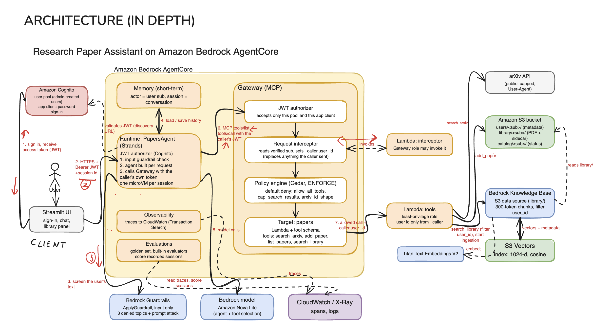

# Research Paper Assistant on Amazon Bedrock AgentCore

A research assistant where a signed-in user can search arXiv, save papers to a personal library, and ask questions about those papers. Answers cite the paper title and page, and the agent says so when something is not in the library.

Built as a tutorial on **Amazon Bedrock AgentCore**: a Strands agent on Runtime, tools behind a Gateway, per-user isolation from the login token, and guardrails, memory, observability and evaluations around it.

> It creates billable AWS resources: see [Cleanup](#cleanup).

## Architecture



| Layer | What it does |
|---|---|
| **UI** (Streamlit) | Signs the user in with Cognito and chats with the deployed agent, showing which tool was used |
| **Identity** (Cognito) | Issues the JWT. Runtime and Gateway both validate it, and the user ID comes only from the token |
| **Guardrail** (Bedrock) | Checks each question first. Off-topic and attack requests are refused before any tool, model or memory call |
| **Runtime** (Strands agent) | Built per request for the caller. Gets the tool list from the Gateway and lets the model choose tools |
| **Memory** (AgentCore) | Short-term memory per user and conversation |
| **Gateway** (MCP) | Exposes the tools, checks the token, runs the interceptor and enforces Cedar policy rules |
| **Interceptor** (Lambda) | Writes the verified user ID into every tool call, so the model cannot choose whose library it reads |
| **Tools** (Lambda) | Four tools: `search_arxiv`, `add_paper`, `list_papers`, `search_library` |
| **Storage** (S3, Knowledge Base) | Per-user PDFs and a Knowledge Base filtered by user ID for cited answers |
| **Observability** | Traces in CloudWatch: every model call, tool call and memory step |
| **Evaluations** | A golden question set scored with AgentCore Evaluations |

## Repository layout

| Folder | Contents |
|---|---|
| `docs/` | Step-by-step notes, one file per part (identity, storage, tools, interceptor, guardrails, gateway, agent, deployment, evals) |
| `ResearchAssistant/` | The AgentCore project: agent code (`app/`) and configuration (`agentcore/`) |
| `lambda/` | Tools Lambda, interceptor Lambda and `tool_schema.json` |
| `knowledge-base/`, `iam/`, `guardrails/` | Templates for the Knowledge Base, IAM roles and the guardrail |
| `policies/` | Cedar policy rules for the Gateway |
| `scripts/` | Helpers: get a JWT, call and check the Gateway, attach the interceptor, set the guardrail |
| `ui/` | The Streamlit app |
| `evals/` | The golden dataset and the evaluation runner |

## Prerequisites
- An AWS account, region `us-east-1`, and Amazon Bedrock model access enabled
- AWS CLI, the AgentCore CLI (`@aws/agentcore`), Python 3 and `uv`
- A `.env` file with your account, region, prefix and test users (see `docs/Part 1-2`)

## How to build it
Follow the notes in `docs/` in order: identity, storage and Knowledge Base, tools, interceptor, guardrails, gateway and policy, agent setup, deployment, then the UI and evaluations.

## Template files
Files ending in `.tmpl` (IAM policies, Knowledge Base settings, Lambda environment, Cedar rules) hold `${VARIABLE}` placeholders such as the account ID, region, prefix and resource IDs. When a step in `docs/` says "replace variables", fill in the file like this:

```bash
set -a; source .env; set +a                                   # load your values
python3 scripts/replace_env.py knowledge-base/kb-permissions.json.tmpl   # writes knowledge-base/kb-permissions.json
```

- The output has the same name without `.tmpl` (`kb-permissions.json.tmpl` becomes `kb-permissions.json`). Use that file in the command that follows. To write somewhere else, add a second argument: `replace_env.py lambda/tools-access.json.tmpl iam/tools-access.json`.
- The script stops with a list of the missing variables if any placeholder has no value, so a blank never ends up in an ARN or a policy.

| Template | Renders to | Variables | Used for |
|---|---|---|---|
| `knowledge-base/kb-trust-policy.json.tmpl` | `kb-trust-policy.json` | `ACCOUNT_ID`, `REGION` | Knowledge Base role trust policy |
| `knowledge-base/kb-permissions.json.tmpl` | `kb-permissions.json` | `ACCOUNT_ID`, `BUCKET`, `PREFIX`, `REGION` | Knowledge Base role permissions |
| `knowledge-base/create-kb.json.tmpl` | `create-kb.json` | `ACCOUNT_ID`, `PREFIX`, `REGION` | Create the Knowledge Base |
| `knowledge-base/create-data-source.json.tmpl` | `create-data-source.json` | `ACCOUNT_ID`, `BUCKET`, `KB_ID` | Create the data source |
| `lambda/tools-access.json.tmpl` | `iam/tools-access.json` | `ACCOUNT_ID`, `BUCKET`, `KB_ID`, `REGION` | Tools Lambda permissions |
| `lambda/tools-env.json.tmpl` | `lambda/tools-env.json` | `BUCKET`, `DATA_SOURCE_ID`, `KB_ID` | Tools Lambda environment |
| `iam/lambda-trust-policy.json.tmpl` | `iam/lambda-trust-policy.json` | none | Lets Lambda assume the tools and interceptor roles |
| `iam/interceptor-invoke-policy.json.tmpl` | `iam/interceptor-invoke-policy.json` | `ACCOUNT_ID`, `PREFIX`, `REGION` | Lets the Gateway invoke the interceptor |
| `guardrails/create-guardrails.json.tmpl` | `guardrails/create-guardrails.json` | `PREFIX` | Create the guardrail |
| `policies/cap_max_results.cedar.tmpl` | `policies/cap_max_results.cedar` | `ACCOUNT_ID`, `GATEWAY_ID`, `REGION` | Cedar rule: cap `max_results` on `search_arxiv` |
| `policies/arxiv_id_match.cedar.tmpl` | `policies/arxiv_id_match.cedar` | `ACCOUNT_ID`, `GATEWAY_ID`, `REGION` | Cedar rule: `add_paper` needs a valid arXiv ID |
| `ResearchAssistant/app/ResearchAssistantAgent/policies/allow_guardrails.json.tmpl` | `allow_guardrails.json` (same folder) | `ACCOUNT_ID`, `GUARDRAIL_ID`, `REGION` | Agent permission to call the guardrail |

- Render each template at the step that needs it. Some values (such as the Gateway ID or the Knowledge Base ID) only exist after an earlier step, and you add them to `.env` as you go.
- Rendered files contain your own account details. They are generated, so do not edit them by hand and do not commit them.

## Evaluations
After the three golden papers show `READY` in the test user's library:

```bash
python3 evals/run_evals.py invoke
python3 evals/run_evals.py evaluate --run latest
python3 evals/run_evals.py report --run latest
```

`invoke` asks the 15 questions, `evaluate` scores the recorded sessions, and `report` prints the score table. Each run is saved under `evals/runs/`.

## Cleanup
Delete the AgentCore stack, the Lambda functions, the Knowledge Base, the S3 bucket, the guardrail and the Cognito pool when you are done. The steps and their order are in `docs/Part 11 - Cleanup.txt`.
